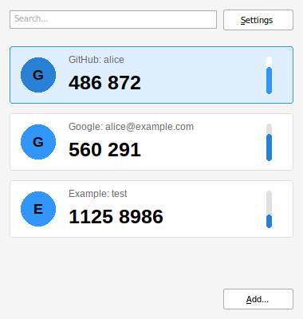

# otp4win

A TOTP client for Windows, written in Go with [Windigo](https://github.com/rodrigocfd/windigo).
It has the features of [open-otp](https://github.com/avan1235/open-otp), but
uses plain Win32 controls and GDI drawing (no OpenGL), so it works well over RDP.

## Features

- A list of code cards showing the issuer initial, "Issuer: account", the code
  and a countdown bar that empties and turns red in the last seconds.
- Click a card (or press Enter) to copy its code.
- Search on issuer and account name (Ctrl+F, Esc clears).
- Add codes by hand (Ctrl+N) with issuer, account name, secret, algorithm
  (SHA1/SHA256/SHA512), digits (6/8) and period (15/30/60 s).
- Paste an `otpauth://` link (Ctrl+V in the main window, or in any field of the
  add dialog) to fill in everything at once. Google Authenticator exports
  (`otpauth-migration://`) add all their TOTP accounts. HOTP (counter based)
  codes are not supported.
- Delete with the Delete key or the right-click menu, with optional confirmation.
- Reorder with drag and drop or Ctrl+Up/Down, or sort by issuer or account name
  with optional group headers, empty values first and reverse order.
- Windows colors, following the light/dark app mode and high contrast themes
  automatically (or forced light or dark).

Codes are saved in `%APPDATA%\otp4win\accounts.dat`, encrypted with DPAPI
for the current Windows user. Settings are in `settings.json` next to it. The
`secret.dat` of earlier versions is migrated on first start.

## Install

Download the MSI from the [releases](https://github.com/mevdschee/otp4win/releases)
and run it. It installs `otp4win.exe` in Program Files and adds an "otp4win" shortcut
to the Start menu. Newer versions replace older ones.

## Build (on Linux)

Install the tools once:

    sudo apt install jq wixl msitools
    go install github.com/tc-hib/go-winres@latest

The icon, manifest (visual styles, DPI awareness) and version info are compiled
from `winres/` into `rsrc_windows_amd64.syso`, which is not committed. Generate
it before building (`go generate` needs `~/go/bin` in your `PATH`):

    go generate
    GOOS=windows GOARCH=amd64 go build -ldflags="-H windowsgui -s -w" -o otp4win.exe .

## Release

The version is set in `winres/winres.json` (`file_version`, as
`major.minor.patch.build`). Change the first three numbers by hand for a new
version; the build number is bumped automatically.

    ./package.sh   # bump build number, build dist/otp4win-<version>-amd64.msi
    ./release.sh   # create GitHub release v<major.minor.patch> with the MSI

`release.sh` runs `package.sh` when the MSI is missing and takes an optional
release title as argument. The installer is defined in `installer/otp4win.wxs`.

## Test

    go test .
    wine otp4win.exe
