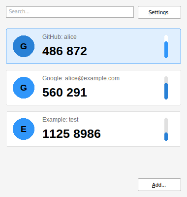

# otp4win

Your two-factor codes on your Windows desktop, without reaching for your phone
and without an account or a cloud: the codes are encrypted for your Windows
user and never leave your computer.

otp4win is a TOTP (two-factor authentication code) client for Windows, written
in Go with [Windigo](https://github.com/rodrigocfd/windigo). It is inspired by
[open-otp](https://github.com/avan1235/open-otp), but uses plain Win32 controls
and GDI drawing (no OpenGL), so it starts fast and works well over RDP.

## Features

- Each code is shown on a card with the issuer initial, "Issuer: account", the
  code and a countdown bar that empties and turns red in the last 5 seconds.
- Click a card to copy its code to the clipboard.
- Add codes by hand with issuer, account name, secret, algorithm
  (SHA1/SHA256/SHA512), digits (6/8) and period (15/30/60 seconds).
- Paste an `otpauth://` link to add a code at once, either in the main window or
  in any field of the add dialog. Pasting a Google Authenticator export link
  (`otpauth-migration://`) adds all its TOTP accounts. otp4win cannot scan QR
  codes, so decode the export QR code first (for instance with a QR scanner app
  on your phone or `zbarimg` on Linux) and copy the link it contains.
- Search on issuer and account name.
- Reorder with drag and drop, or sort by issuer or account name with optional
  group headers, empty values first and reverse order.
- Delete from the right-click menu, with optional confirmation.
- Uses the Windows colors and follows the light/dark app mode and high contrast
  themes automatically. Light or dark can also be forced in the settings.
- Scales with the Windows display scaling (DPI).
- Checks for a newer release on startup and installs it on request, or opens
  the download page in a portable copy.

HOTP (counter based) codes are not supported. There is no export, and codes
cannot be added by scanning a QR code.

## Keyboard

| Key                    | Action                                       |
| ---------------------- | -------------------------------------------- |
| Ctrl+V                 | Add the `otpauth://` link from the clipboard |
| Ctrl+N                 | Add a code                                   |
| Ctrl+F                 | Search                                       |
| Esc                    | Clear the search                             |
| Up, Down, Home, End    | Select a code                                |
| Enter, Space or Ctrl+C | Copy the selected code                       |
| Ctrl+Up, Ctrl+Down     | Move the selected code (when not sorted)     |
| Delete                 | Delete the selected code                     |

## Install

Download `otp4win-<version>-amd64.msi` from the
[releases](https://github.com/mevdschee/otp4win/releases) and run it. It
installs `otp4win.exe` in `%LOCALAPPDATA%\Programs\otp4win` and adds an
"otp4win" shortcut to the Start menu. It installs for the current user only,
so it does not need admin rights. Newer versions replace older ones. The
installer is signed by Maussoft B.V., see "Code signing" below.

To use it without installing, download `otp4win-<version>-amd64.exe` instead
and run it from anywhere. It is the same program the installer installs. The
codes and settings still go to `%APPDATA%\otp4win`, and when an update is
available it offers the download page instead of installing. For Windows on
ARM there is `otp4win-<version>-arm64.exe`, a native build that is only
available as a portable exe; the installer works there too, but runs the amd64
build emulated.

Each release has a `SHA256SUMS` file. To check a download, compare its hash
with the one listed there, for example in PowerShell:

    Get-FileHash otp4win-<version>-amd64.exe

### Code signing

Since version 0.3.7 the installer and the exes are signed with a Certum code
signing certificate issued to Maussoft B.V. To check, right-click the file in
Explorer, choose Properties and open the "Digital Signatures" tab. SmartScreen
may still warn about a new release until enough people have downloaded it
("More info", "Run anyway"). Do not run a file that is not signed by Maussoft
B.V. The source and the build script are in this repository, so you can also
build the exe yourself.

It runs on 64-bit Windows 10 and 11.

## Data

Codes are saved in `%APPDATA%\otp4win\accounts.dat`, encrypted with DPAPI so
only the current Windows user can read them. Settings are in `settings.json`
next to it. Your codes never leave your computer.

## Updates

Settings has a "Check for updates" link that asks GitHub for the latest
release. When a newer version is available it offers to download the MSI and
install it; otp4win closes while the installer runs. A portable copy offers the
download page instead. Nothing is checked automatically, so this is the only
network access and only happens when you click the link.

## Build (on Linux)

Install the tools once:

    sudo apt install jq wixl msitools
    go install github.com/tc-hib/go-winres@latest
    echo 'export PATH="$PATH:$HOME/go/bin"' >> ~/.bashrc && source ~/.bashrc

The icon, manifest (visual styles, DPI awareness) and version info are compiled
from `winres/` into `rsrc_windows_amd64.syso`, which is not committed. Generate
it before building (`go generate` needs `~/go/bin` in your `PATH`):

    go generate
    GOOS=windows GOARCH=amd64 go build -ldflags="-H windowsgui -s -w" -o otp4win.exe .

## Test

    go test .
    ./run.sh

`run.sh` checks that `go`, `go-winres` and `wine` are installed, builds
`otp4win.exe` and runs it with Wine (`sudo apt install wine`). Wine has its own
`%APPDATA%`, so the codes you add there are kept apart from a real install.

## Release

    ./release.sh          # 0.3.3 -> 0.3.4 (build, the default)
    ./release.sh minor    # 0.3.4 -> 0.4.0
    ./release.sh major    # 0.4.0 -> 1.0.0

`release.sh` needs a clean working tree. It raises the version in
`winres/winres.json` (`file_version`, as `major.minor.build.revision`; the
revision goes up on every release), runs the tests, builds
`dist/otp4win-<version>-amd64.msi`, the portable
`dist/otp4win-<version>-amd64.exe` and `dist/otp4win-<version>-arm64.exe` and
`dist/SHA256SUMS`, commits and pushes the version bump and creates the GitHub
release with those four files. wixl cannot build an arm64 MSI, so arm64 is
only a portable exe. Besides the build tools above it needs the GitHub CLI
(`gh`). The installer is defined in `installer/otp4win.wxs`. `release.sh`
signs the exes and the MSI with jsign and the Certum certificate in
SimplySign; start SimplySign Desktop and connect it first. The settings are at
its top.
